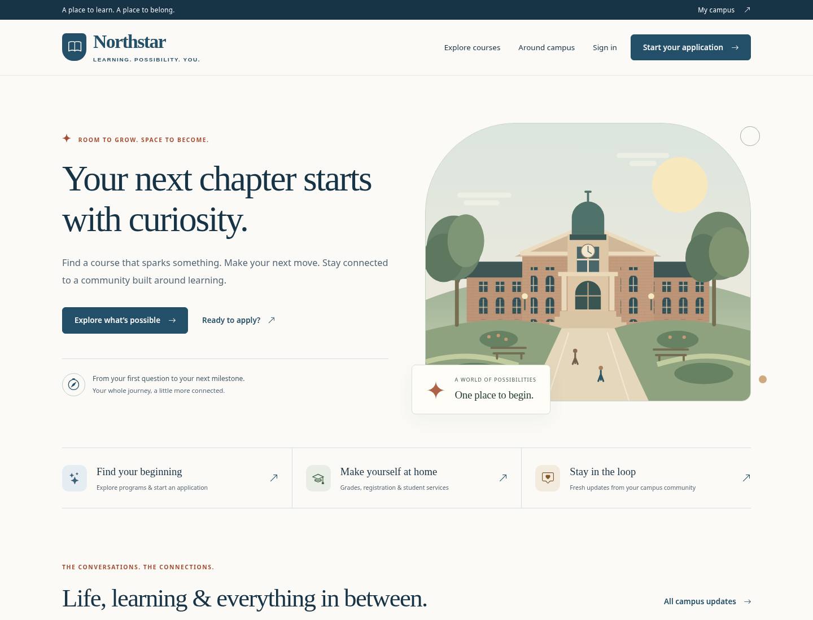
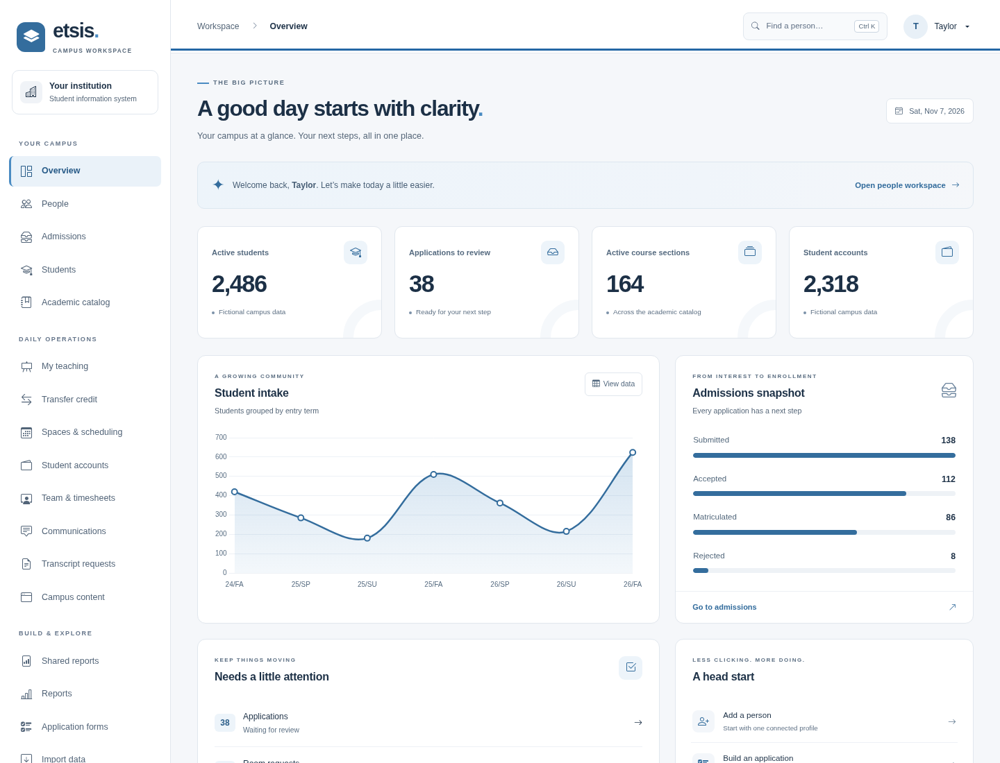

# etSIS

## Version 10 - A New Beginning

## Alpha development

The application is in active alpha. Breaking changes and necessary database migrations are expected. We evolve one current domain model instead of maintaining a new class for each development-era field addition. Release compatibility will be stabilized during release-candidate planning. Historical publications and student/financial decisions remain distinct, preserved facts.

## Install and setup for alpha testing

Developers are welcome to try etSIS and help improve it. Use a separate local installation with fictional data: alpha code and schemas can change between updates. The walkthrough below uses the included DDEV configuration, which provides PHP 8.4, MariaDB and Node.js 24. Install Git, DDEV and a supported container provider before starting.

>   You will need to follow this along with the [CodefyPHP docs](https://codefyphp.com/docs/getting-started/installation/) as well for an installation with or without DDEV.

### 1. Get the project and install dependencies

```sh
git clone https://github.com/nomadicjosh/etsis.git
cd etsis
ddev start
ddev composer install
ddev composer setup-environment
```

`setup-environment` creates `.env` from `.env.example` when needed and fills `APP_BASE_PATH` with the project path inside the container. Keep that generated path. The command preserves an existing configured environment.

### 2. Configure the local environment

Edit `.env` for the included DDEV project:

```dotenv
APP_NAME=etsis
APP_BASE_URL=https://etsis.ddev.site
APP_DEBUG=false
DB_CONNECTION=mysql
DB_DSN="mysql:host=db;port=3306;dbname=db;charset=utf8mb4"
DB_USER=db
DB_PASSWORD=db
COOKIE_SECURE=true
COOKIE_DOMAIN=''
COOKIE_PATH=/
COOKIE_SAMESITE=lax
```

`db`/`db` are DDEV's local database credentials. Set `APP_KEY` to your own generated value; `ddev exec openssl rand -hex 32` generates a suitable value in your terminal. Keep `.env` private. If you change the DDEV project name, use its corresponding HTTPS URL in `APP_BASE_URL`. Optional external services can remain disabled.

### 3. Create the encryption key, database tables and frontend assets

```sh
ddev codex generate:key:file
ddev codex migrate
ddev exec npm ci
ddev exec npm run build:assets
```

Generate `.enc.key` **once for a new installation**. Reuse it when it already exists, retain it with your database backups, and keep it outside version control. Recorded encrypted history cannot be recovered simply by generating a replacement key. The application requires writable `storage/` directories; DDEV handles the normal local permissions.

### 4. Register your account and grant initial administrator access

Open [the registration page](https://etsis.ddev.site/register/) and create your own account using a fictional name/email and a password of at least **26 characters**. Usernames use 6–20 lowercase letters, underscores or hyphens; for example, `alpha_tester`. Registration creates a person record and its ordinary sign-in account together. Staff-created people also receive an account, with private [initial password setup](docs/person-identity-and-accounts.md).

Then run:

```sh
ddev codex sis:access:bootstrap
```

Enter that account's email at the hidden prompt, then confirm granting the first `super` administrator role. No password is requested by this command. Bootstrap refuses further grants once a super administrator exists; subsequent access changes belong in **Roles & access**.

Sign in at [the etSIS login page](https://etsis.ddev.site/login/) and open [the staff workspace](https://etsis.ddev.site/admin/). Explore the public portal at [Campus portal](https://etsis.ddev.site/portal/). A fresh installation has system roles and permissions, but no demonstration student/course records. Start with [academic calendar setup](docs/academic-calendar-setup.md) and [grading scales](docs/grading-scale-setup.md), then create fictional catalog and student data as you explore.

### 5. Test, update and give feedback

Run the PHP checks with a bounded memory limit:

```sh
ddev exec php -d memory_limit=192M vendor/bin/phpunit
```

For an existing alpha checkout, review the [roadmap](docs/development-roadmap.md) and relevant migration/setup notes, then update dependencies, migrations and assets:

```sh
git pull
ddev composer install
ddev codex migrate
ddev exec npm ci
ddev exec npm run build:assets
```

Preserve your encryption key and environment when updating. Some alpha changes may require an explicit data conversion or a new disposable test database; a fresh-install walkthrough is not a data-upgrade procedure.

Please [open a GitHub issue](https://github.com/nomadicjosh/etsis/issues) with your commit (`git rev-parse --short HEAD`), environment, steps to reproduce, expected result and actual result. Include a sanitized error or screenshot using fictional data when useful. Workflow and accessibility feedback are welcome. Keep passwords, keys, tokens and real student/staff data out of reports; use a private reporting channel for security findings.

## Screenshots

Screenshots use a test campus and demonstration data. No real student or staff records are shown.

### Campus portal

The public portal welcomes prospects and connects students with applications, courses, campus updates, and student services.



### Backend dashboard

The staff workspace brings campus metrics, student intake, admissions, and review queues into one dashboard.



## Setup documentation

[Term types, academic years and terms](docs/academic-calendar-setup.md) explains calendar setup and automatically derived matriculation cohorts. [Initial student matriculation](docs/student-matriculation.md) explains the admissions review, first-program history and retry behavior.

[Application submission history](docs/application-submission-history.md), [admissions decisions](docs/admissions-decisions.md), and [outcome corrections](docs/admissions-corrections.md) describe retained history, staff permissions and reviewed corrections before matriculation.

[Course subjects](docs/course-subjects.md) explains explicit subject setup, draft assignment and historical publication references.
[Departments and levels](docs/course-classifications.md) explains their searchable setup, combined course assignment and retained publication/report labels.

[Saved report settings](docs/workflow-review.md#saved-report-results-and-automatic-removal) covers static captures, live dynamic reports, optional expiry and scheduled cleanup.

[Report-selected registration](docs/workflow-review.md#register-students-selected-from-a-saved-report) explains choosing up to 25 distinct students from a saved detail report and opening the existing group-registration review, with independent permissions and no enrollment or charge before confirmation.

[Latest registration reporting](docs/workflow-review.md#latest-registration-reports) finds each student’s latest term by dates, including an optional list of students with no retained registration. [Related-record conditions](docs/workflow-review.md#related-record-conditions) require or exclude matching registrations and other records without duplicating report rows. [General report design](docs/workflow-review.md#general-report-design-and-named-joins) covers independent named joins and connected admissions, registration and recorded-credit sources. [Submission-date reports](docs/application-submission-history.md#submission-date-reporting) filter actual applications by recorded submission dates while keeping earlier unknown dates explicit.

[Published program details](docs/program-publication.md) explains combined program/award setup, academic-year publication and retained student cohort labels. Program publications also retain offered specializations and selection limits: institutional ceilings/defaults, program-specific restrictions and optional or required selection. Staff can [review specialization choices within a student’s pursuit](docs/student-program-assignments.md#specialization-choices-within-a-pursuit) against that retained publication. The [specialization requirements builder](docs/degree-audit-builder.md#specialization-requirements) now reuses the group composer, retained publication/cloning and independent runtime student tests. Staff can [assign exact specialization requirement publications](docs/student-program-assignments.md#assign-published-specialization-requirements) from the student pursuit with reviewed history and retained version inspection. An [independent specialization progress review](docs/student-degree-progress.md#assigned-specialization-review) now uses the assigned publication and verified current work through the existing evaluator. Program publications now retain [configurable sharing between degree and specialization requirements](docs/program-publication.md#course-sharing-between-curriculum-components), and the normalized allocator enforces component and group-sharing rules separately. A [combined curriculum progress review](docs/student-degree-progress.md#combined-curriculum-progress) now connects exact assigned components to one verified input collection and sharing-aware search, with captured drilldowns and no saved academic result. The same workflow now supports [specialization exceptions and reviewed course routing](docs/student-degree-exceptions.md#specialization-exceptions-and-course-routing), plus owner-only portal progress. Retained final evaluations and graduation decisions remain separate roadmap milestones.

## Development priorities

[Development roadmap](docs/development-roadmap.md) summarizes working foundations, remaining milestones, relative effort and release acceptance, with historical integrity and security first.

Security, student privacy and historical academic integrity lead continued development. Read the [event-sourcing direction](docs/event-sourcing.md), [architecture and retrofit review](docs/event-sourcing-architecture.md), and [legacy academic field review](docs/academic-history-field-review.md) before changing academic or financial workflows. These reviews distinguish existing capabilities from required implementation work.

[Institutional credit history](docs/academic-credit-history.md) now connects registration, reviewed final grades, reasoned registrar corrections and early/late drops in the shared journal. Credits retain known grading-policy references; older facts are explicitly observed without invented prior authors or dates. [Transfer award history](docs/transfer-credit-history.md) now preserves reviewed source facts, effective-dated corrections and void/reinstatement grading policy in that same journal.

[Registration history](docs/registration-history.md) now preserves accepted seats, early/late releases and committed section decision order, with registrar-only access to restricted early-drop history.

The [single protected event store](docs/event-history-foundation.md) serves the framework and domain ports. Its migration converts and verifies existing User/financial events before removing the old event table. Academic writers and richer command attribution still require the documented staged conversion.

Operators can run `ddev codex sis:history:verify` for a bounded, read-only check of protected event chains, event references and retry receipts, including orphan detection and original request-fingerprint verification. [Limits, continuation and exit codes](docs/event-history-foundation.md#read-only-operator-verification) explain its scope; projection reconciliation and verified restores remain subsequent work.

The first [published course-definition workflow](docs/course-publication.md) preserves reviewed course codes, catalog/transcript titles, descriptions, fixed credits and prerequisite identities. Course reviews expire after 20 minutes; confirmation retains the actual decision time, while earlier events and completed receipts remain intact. Empty sections can explicitly retain a selected publication; offering-plan publication now reviews and retains those choices with activation in one transaction. New institutional credits preserve the selected reference. [Published section details](docs/section-publication.md) now retain reviewed instructional dates, capacity, delivery, canonical teaching identity and fees. A verified indexed section-version cache now accompanies new publications. New registrations can retain explicitly selected section versions; reviewed amendments update the selection for future registrations while preserving earlier student references and charges. Offering-plan activation now retains reviewed section versions and instructional dates in the same transaction. Complete policy definitions remain subsequent stages; institutional credit creation, grades and drops already use the shared journal described above.

[Optional Moodle integration](docs/optional-moodle-integration.md) combines installation approval, reviewed person-account linking/creation, direct launch and mapped-section student/instructor access in the existing workspaces. Institutions enable each external effect explicitly; normal SIS workflows remain available without Moodle.

Download the [connector 0.6.0-alpha ZIP](dist/moodle/local_etsis-0.6.0-alpha.zip), verify its [SHA-256 checksum](dist/moodle/local_etsis-0.6.0-alpha.zip.sha256), then follow the [installation guide](integrations/moodle/local/etsis/README.md). Upgrade in place to preserve installation identity and receipts. Rebuild distributions with `python3 tools/package-moodle.py`.

[Account setup](docs/moodle-person-links.md) supports linking an existing Moodle account or requesting creation with institutional SSO or a password-setup email. The bounded worker retains the resulting link automatically. Bounded automatic retries and the existing reviewed original-account recovery cover uncertain outcomes; no additional recovery workflow is planned without a demonstrated need. [Direct Moodle launch](docs/moodle-direct-launch.md) uses separate native cookies with a retained etSIS sign-in deadline and server-side validation.

[Section access synchronization](docs/optional-moodle-integration.md#section-course-mapping-and-background-access) links a published SIS section to an existing Moodle course, then reconciles current student and instructor access in bounded background runs. Drops, role changes and instructional access windows suspend connector-owned access while retaining learning records. Section publication can queue course creation under an automatically synchronized subject or department category, selected in etSIS. Existing Moodle categories can be linked explicitly. Opt-in first-use provisioning creates and links eligible missing student/faculty accounts through the existing account worker before roster access. Gradebook import and native institutional acceptance remain open.

[Space scheduling](docs/backend-workspace.md#recurring-meeting-requests) supports recurring room requests with weekday patterns, closures, overnight meetings and a paged conflict review. Approval checks every occurrence together; accepted requests retain explicit UTC meetings without a recurring worker. Rooms have separate codes and names, with searchable building setup and linked building identities. The campus booking calendar adds building/text filters and institution-timezone day views across rooms, with approved/requested counts and connected booking decisions. Campus and room calendars share week/month switching, daily details and filters that survive connected booking actions. Staff can cancel or review a room/time move for one meeting while preserving the rest of its booking and the original meeting history. Label entries with accessible categories and link course-section room meetings to their exact published offering, using its instructional dates in the shared planner. Category changes preserve the actual class link; rescheduling keeps the retained offering reference. Online and hybrid sessions use the same planner without a physical room, and can move between online and room locations. The calendar filters by location. [Section meeting plans](docs/section-publication.md#published-meeting-plans) now publish the approved physical/online schedule through a reasoned review, retaining earlier times, rooms and offering references. [My timetable](docs/section-publication.md#personal-academic-timetable) now gives students and assigned instructors an owner-only term/week/month view of published class times, with retained locations and combined learning/teaching roles. [Possible-overlap reviews](docs/section-publication.md#possible-schedule-overlaps) now identify overlapping published times and offer inline comparisons. Team teaching and institutional conflict policies remain future work.

[Public campus events](docs/public-campus-events.md) now publish explicitly reviewed invitations and approved room and online meeting dates in a searchable portal calendar, with week/month views, daily pages and a live Vihzhuo block. Public content stays separate from internal purposes and class meetings; cancellations hide affected dates and replacements require review. Staff can prepare an editable announcement from the published invitation, then review recipients and delivery through the existing encrypted Communications workflow.

[Booking updates](docs/booking-updates.md) give requesters a private place to review approvals, cancellations and rescheduled meetings. Read tracking keeps newer changes visible without changing the booking revision or sending email.

[Reviewed course imports](docs/course-publication.md#reviewed-course-imports) now show catalog matches and conflicts before confirmation, with explicit linking/exclusions, inactive new drafts, searchable row pages and safe retries that preserve original results. Optional subject, department, academic-level and course-level columns resolve to existing catalog entries; authorized staff can correct missing references through the connected setup drawers without losing their file. Existing course details and historical publications remain intact.

[Student-account reports](docs/workflow-review.md#student-account-reports) now use the same Report Studio for outstanding balances, available credit and billing-term charge/payment/refund summaries. Current balances update atomically with financial events, so report reads need no replay. Currency separation, safe joins and independent finance/student permissions apply to live, shared and fixed reports.

[Account postings and corrections](docs/workflow-review.md#account-postings-and-corrections) require a reason and the displayed account position. Refreshing the balance preserves form values; accepted retries preserve the original posting and reason. Staff and automated account commands retain trusted attribution in the existing protected journal, while earlier unknown context remains unchanged.

[Billing rules and ledger journals](docs/workflow-review.md#billing-rules-and-ledger-journals) now share those financial safeguards: required reasons, stable creation IDs, stale-change checks and atomic audits. Retrying creation preserves later retirement/reversal and the original reason. Existing financial history needs no conversion.

[Holds and restriction history](docs/registration-history.md#holds-and-restriction-history) now preserves person-owned placements and reasoned end-date changes in the shared journal. Authorized staff can review earlier decisions; registration checks the current hold inventory against that history. Private notes remain separate and encrypted. A dedicated office worklist and dated staff delegation now use a separate hold-management permission. [Set up office scope](docs/registration-history.md#set-up-offices-and-delegate-hold-work) through Roles & access. Designated coordinators can [review an office handoff](docs/registration-history.md#hand-off-a-hold-to-another-office), explicitly approve the receiving office's private-history access and retain the original hold effects and decisions. [Individual follow-up](docs/registration-history.md#individual-follow-up) now adds colleague assignment, optional dates and personal/due filters within that same worklist, without granting access or creating another queue.

[Communications](docs/communications.md) provides private templates, reviewed institutional template sharing, independent draft copies, searchable recipient checkboxes and a complete message-and-audience review. Send now or schedule a future start in the institution's time zone, confirm once, then leave the screen; the server worker sends bounded batches and the campaign's progress bar shows scheduled status, confirmed sends and messages needing attention. A running server scheduler and enabled institutional mail are required.

[Human resources](docs/human-resources.md) combines job/pay-grade setup, retained hire/end/rehire dates, dated employee position agreements, employment change history and weekly time review. Pay grades, jobs and retained agreements support hourly, monthly and annual rates without automatic conversion. Ending employment reviews and saves affected position closures together. New time entries retain the worked position and its accepted version, while submission and approval check the recorded employment and assignment dates. Earlier unassigned work stays explicit. Position changes retain the reviewed job and compensation terms while closing the old agreement and recording the new one together. Private HR access and protected history preserve the canonical Person identity; payroll remains future work.

[Session-reference housekeeping](docs/sign-in-session-retention.md) now provides a bounded operator command that previews by default and explicitly removes eligible expired references with a grace period, preserving unexpired revocations and remaining launch references. It runs independently of normal page loads and leaves academic history unchanged.

[Optional catalog authoring assistance](docs/optional-authoring-assistance.md) adds consent-based readiness suggestions, course/program description drafts and saved-description rewrite/expansion, plus saved-section, reusable-group and selected degree-composition readiness checks with separate action permissions and replaceable providers. It is disabled until the institution configures a service and approves its data policy. The [degree-progress guide](docs/student-degree-progress.md#dockable-local-guide) stays local and explains captured staff and owner-only student-portal reviews without sending student data to a provider.

The [course group library and degree audit builder](docs/degree-audit-builder.md) provide independent reusable course groups and visual program/year compositions, with checkboxes, drag-and-drop and expandable requirement previews. Degrees retain exact published group versions and institutional policy inputs. A [reviewed student-program assignment](docs/student-degree-requirements.md) retains a specific degree version and actual pursuit start date. Protected [student exceptions](docs/student-degree-exceptions.md) now support course waivers, reviewed substitutions and credit/GPA minimum reductions within one program pursuit. Course groups support credit or course-count totals and optional per-course grade-point minimums. [Global/program grading scales](docs/grading-scale-setup.md) retain score ranges, GPA treatment and approved publication snapshots. The scale editor supplies immutable grade definitions to final-grade, transfer and late-drop workflows; existing records retain their exact grade IDs. A [paged academic-work review](docs/student-academic-work.md) verifies current institutional/transfer records and retained grade facts; **Check requirement matches** explains potential uses against retained requirements and approved exceptions without allocating courses. A [bounded structural allocation engine](docs/degree-audit-allocation.md) now handles overlapping groups and named/quantity constraints. A [retained repeat-credit/GPA calculation core](docs/degree-audit-calculations.md) now separates earned awards, weighted GPA and unresolved historical inputs. [Pursuit-specific academic-work review](docs/academic-input-verification.md#which-pursuit-can-use-the-work) now confines prerequisites and audit inputs to the selected pursuit, with explicit registrar approval for earlier-work reuse. [Registration history](docs/registration-history.md#retained-prerequisite-evidence) now retains exact prerequisite support, and group registration shows readiness before confirmation. The shared command also [rechecks access, deadlines and dated holds before completion](docs/registration-history.md#registration-completion-checks), rolling back all coupled effects on failure. A [single-screen program change](docs/student-program-assignments.md#change-program) creates/selects the new pursuit and closes the former one atomically while preserving student activity and original academic work. Its next action opens [earlier-coursework review](docs/academic-input-verification.md#registrar-review), with cross-page selection and one atomic confirmation for up to 20 reuse approvals. Each work card also opens [attribution and reuse history](docs/academic-input-verification.md#attribution-and-reuse-history) without losing the selection or reason. An on-demand [academic input verification](docs/academic-input-verification.md) cross-checks available current and historical references under bounded replay, without returning partial inputs or removed-record details. The [Credits & GPA review](docs/student-credit-gpa-review.md) now connects verified current inputs and the selected degree policies, explains record contributions and keeps unknown totals distinct from zero. New degree publications can retain [repeat-attempt ordering](docs/repeat-attempt-ordering.md), and latest-attempt GPA can use exact retained instructional dates. An on-demand [course-group placement review](docs/student-course-placement.md) now applies verified work, group eligibility, repeat-credit rules, sharing and approved exceptions without returning speculative partial plans. The combined [Degree progress review](docs/student-degree-progress.md) includes local next-step guidance and compares approved credit/GPA minimums and course-group placement from one verified read, with separate cumulative and overall GPA scopes. Archive-wide completeness, remaining historical equivalence/chronology evidence, complete degree evaluation, retained results and specialization exclusions remain subsequent stages.

Registrar staff can now approve [course-placement preferences](docs/student-degree-exceptions.md#course-placement-preferences), reserving a curriculum course for a chosen group in one pursuit and degree publication. The existing exception history retains approval and revocation; eligibility, earned credits, GPA and charges keep their independent rules.

Course-group reviews now [explain clear shortages](docs/student-course-placement.md#understanding-shortfalls) in eligible credits, distinct courses and required-course evidence. They also [explain supported shared-course shortages](docs/student-course-placement.md#shared-course-shortages) when overlapping groups compete under the retained one-group policy. These explanations reuse the same bounded inputs without additional replay and keep unresolved evidence separate from unmet requirements.

Degree progress also provides an [unused and pending work review](docs/student-degree-progress.md#unused-and-pending-work). Local filters distinguish completed work unused in a proposed group plan, placement alternatives, institutional attempts awaiting final grades and other recorded outcomes. Posting-term filters and 20-record pages reuse the captured result; earned-credit and GPA treatment remain independent.

Authorized registrars can now [review actual course completion dates](docs/academic-completion-dates.md) separately from grade entry. Reasoned corrections preserve earlier dates in the existing academic stream, and completion-date repeat policies use those retained facts without treating later grade posting as later course completion.

New [transfer awards retain an explicitly selected course publication](docs/transfer-course-publications.md), including its accepted transcript title. The retained reference supports exact course-group matching while equivalency credits remain independent. Earlier unknown awards are not backfilled. Registrar staff can now [review an existing award’s accepted definition](docs/transfer-course-publications.md#review-an-existing-awards-accepted-course), preserving earlier decisions and financial facts while correcting its publication reference and transcript labels.

Transfer staff with academic read access can also [review the sending institution's academic-period start](docs/transfer-academic-periods.md). The existing transfer stream preserves source-period corrections separately from completion dates and local posting terms, and term-based repeat-GPA ordering uses the retained source evidence.

New registrations can now retain an explicitly selected [section offering version](docs/section-publication.md#select-an-initial-offering-version-for-new-registrations), with shared enrollment/academic references and preserved early-drop history. [Reviewed offering amendments](docs/section-publication.md#amend-the-offering-for-future-registrations) change that selection for later registrations without rewriting earlier students or charges. People and student directories are search-first using AJAX, with results limited to 50 per request.
