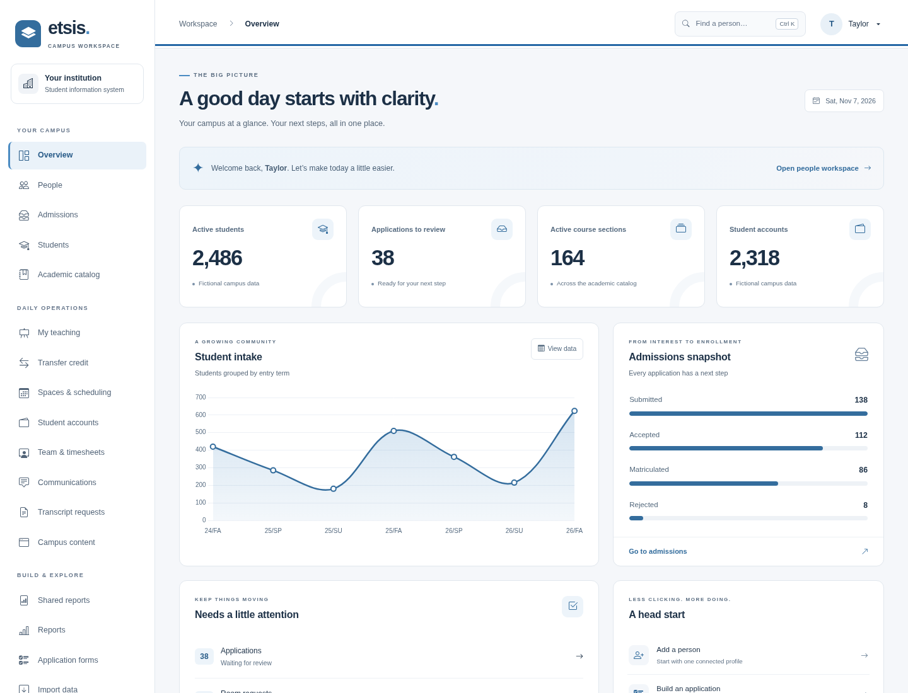

# etSIS

## Version 10 - A New Beginning

## Alpha development

The application is in active alpha. Breaking changes and necessary database migrations are expected. We evolve one current domain model instead of maintaining a new class for each development-era field addition. Release compatibility will be stabilized during release-candidate planning. Historical publications and student/financial decisions remain distinct, preserved facts.

## Screenshots

Screenshots use a test campus and demonstration data. No real student or staff records are shown.

### Campus portal

The public portal welcomes prospects and connects students with applications, courses, campus updates, and student services.

### Backend dashboard

The staff workspace brings campus metrics, student intake, admissions, and review queues into one dashboard.

## Setup documentation

[Term types, academic years and terms](docs/academic-calendar-setup.md) explains calendar setup and automatically derived matriculation cohorts. [Initial student matriculation](docs/student-matriculation.md) explains the admissions review, first-program history and retry behavior.

[Application submission history](docs/application-submission-history.md), [admissions decisions](docs/admissions-decisions.md), and [outcome corrections](docs/admissions-corrections.md) describe retained history, staff permissions and reviewed corrections before matriculation.

[Course subjects](docs/course-subjects.md) explains explicit subject setup, draft assignment and historical publication references.
[Departments and levels](docs/course-classifications.md) explains their searchable setup, combined course assignment and retained publication/report labels.

[Published program details](docs/program-publication.md) explains combined program/award setup, academic-year publication and retained student cohort labels.

## Development priorities

[Development roadmap](docs/development-roadmap.md) summarizes working foundations, remaining milestones, relative effort and release acceptance, with historical integrity and security first.

Security, student privacy and historical academic integrity lead continued development. Read the [event-sourcing direction](docs/event-sourcing.md), [architecture and retrofit review](docs/event-sourcing-architecture.md), and [legacy academic field review](docs/academic-history-field-review.md) before changing academic or financial workflows. These reviews distinguish existing capabilities from required implementation work.

[Institutional credit history](docs/academic-credit-history.md) now connects registration, reviewed final grades, reasoned registrar corrections and early/late drops in the shared journal. Credits retain known grading-policy references; older facts are explicitly observed without invented prior authors or dates. [Transfer award history](docs/transfer-credit-history.md) now preserves reviewed source facts, effective-dated corrections and void/reinstatement grading policy in that same journal.

[Registration history](docs/registration-history.md) now preserves accepted seats, early/late releases and committed section decision order, with registrar-only access to restricted early-drop history.

The [single protected event store](docs/event-history-foundation.md) serves the framework and domain ports. Its migration converts and verifies existing User/financial events before removing the old event table. Academic writers and richer command attribution still require the documented staged conversion.

The first [published course-definition workflow](docs/course-publication.md) preserves reviewed course codes, catalog/transcript titles, descriptions, fixed credits and prerequisite identities. Course reviews expire after 20 minutes; confirmation retains the actual decision time, while earlier events and completed receipts remain intact. Empty sections can explicitly retain a selected publication; offering-plan publication now reviews and retains those choices with activation in one transaction. New institutional credits preserve the selected reference. [Published section details](docs/section-publication.md) now retain reviewed instructional dates, capacity, delivery, canonical teaching identity and fees. A verified indexed section-version cache now accompanies new publications. New registrations can retain explicitly selected section versions; reviewed amendments update the selection for future registrations while preserving earlier student references and charges. Offering-plan activation now retains reviewed section versions and instructional dates in the same transaction. Complete policy definitions remain subsequent stages; institutional credit creation, grades and drops already use the shared journal described above.

The [course group library and degree audit builder](docs/degree-audit-builder.md) provide independent reusable course groups and visual program/year compositions, with checkboxes, drag-and-drop and expandable requirement previews. Degrees retain exact published group versions and institutional policy inputs. A [reviewed student-program assignment](docs/student-degree-requirements.md) retains a specific degree version and actual pursuit start date. Protected [student exceptions](docs/student-degree-exceptions.md) now support course waivers, reviewed substitutions and credit/GPA minimum reductions within one program pursuit. Course groups support credit or course-count totals and optional per-course grade-point minimums. [Global/program grading scales](docs/grading-scale-setup.md) retain score ranges, GPA treatment and approved publication snapshots. The scale editor supplies immutable grade definitions to final-grade, transfer and late-drop workflows; existing records retain their exact grade IDs. A [paged academic-work review](docs/student-academic-work.md) verifies current institutional/transfer records and retained grade facts; **Check requirement matches** explains potential uses against retained requirements and approved exceptions without allocating courses. A [bounded structural allocation engine](docs/degree-audit-allocation.md) now handles overlapping groups and named/quantity constraints. A [retained repeat-credit/GPA calculation core](docs/degree-audit-calculations.md) now separates earned awards, weighted GPA and unresolved historical inputs. An on-demand [academic input verification](docs/academic-input-verification.md) cross-checks available current and historical references under bounded replay, without returning partial inputs or removed-record details. The [Credits & GPA review](docs/student-credit-gpa-review.md) now connects verified current inputs and the selected degree policies, explains record contributions and keeps unknown totals distinct from zero. New degree publications can retain [repeat-attempt ordering](docs/repeat-attempt-ordering.md), and latest-attempt GPA can use exact retained instructional dates. An on-demand [course-group placement review](docs/student-course-placement.md) now applies verified work, group eligibility, repeat-credit rules, sharing and approved exceptions without returning speculative partial plans. Archive-wide completeness, remaining historical equivalence/chronology evidence, full degree evaluation and specialization exclusions remain subsequent stages.

New registrations can now retain an explicitly selected [section offering version](docs/section-publication.md#select-an-initial-offering-version-for-new-registrations), with shared enrollment/academic references and preserved early-drop history. [Reviewed offering amendments](docs/section-publication.md#amend-the-offering-for-future-registrations) change that selection for later registrations without rewriting earlier students or charges. People and student directories are search-first using AJAX, with results limited to 50 per request.
